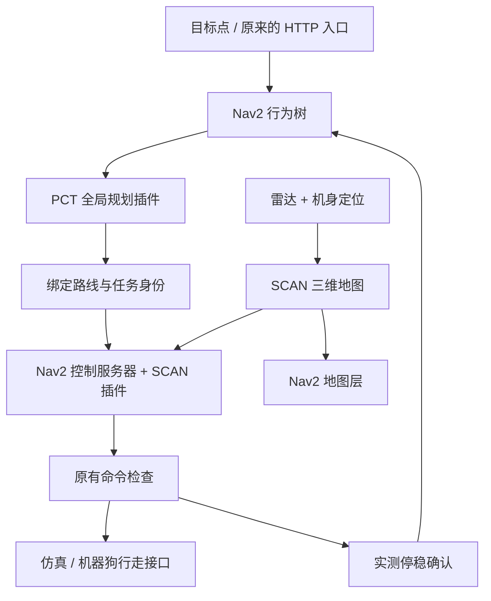

# Lite3 的 Nav2 Foxy 接入

固定使用现有 Jetson：Ubuntu 20.04、ROS 2 Foxy、ARM64。

现在代码的分工是：Nav2 管任务和重试，PCT 算全局路线，SCAN 根据雷达和
三维地图生成可走的轨迹，最后经过原有命令检查才交给机器狗。

这套软件已在本机 ARM64/Foxy 环境编译，并通过到达、取消、路线身份和原生
地图回放测试。原来的物理仿真也已接到同一套 Nav2 入口，仍在处理并记录
真实场景里的失败；不能说机器狗已经能连续走完整条楼梯路线。

建图采用 0.5 秒观测窗口、20 Hz 更新调度，雷达仍是 10 Hz。正常回放的
188 帧全部保留，最终地图相同，最大采样地图年龄约 100 毫秒。人为注入卡顿
时仍会过期，安全检查继续禁止使用旧地图。这与早期 5 Hz 的故障实验分开记录。

Jetson 连接信息明天提供。接入后先查传感器、坐标和时间戳，只接收数据；
目前没有真机测试或真机运动结果。

[详细结果与未解决问题](../../experiments/2026-09-26_newton_stair_reproduction/audits/2026-10-08_nav2_full/REPORT.zh.md)

[技术设计](design.md) · [部署接续说明](DEPLOYMENT.md) · [Foxy 源码核对](source_audit.json)
