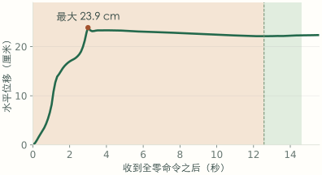
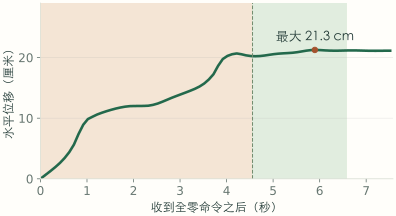

# D07 / CD12：谁喊停，喊停以后又移动多少

2026-10-22。**两次旧运行的遥测复核；新增物理步数 0，控制代码修改 0。**

结论：**D07 是转向先越界、SCAN 再急停；CD12 是外层终点控制在朝向刚达标时停止位置调整。两者的后续大幅移动主要发生在 PD 接管之前，零命令期间仍由 RL 控制。**

## 1. 直接回答

| 测量 | D07 | CD12 |
|---|---:|---:|
| 首次进入终点 25 cm 范围 | 105.354 s | 113.989 s |
| 首次源固体包络越界（采样审计） | 106.873 s | 114.669 s |
| 发布停止 XY 命令 | 107.313 s | 115.093 s |
| 发布完全零命令 | 107.313 s | 115.133 s |
| 遥测中的完全零命令开始生效 | 107.393 s | 115.188 s |
| 零命令生效时离目标中心 | 9.14 cm | 6.96 cm |
| PD 开始接管（STAND_TRANSITION） | 119.966 s | 119.746 s |
| 等待 PD 开始接管 | **12.573 s** | **4.557 s** |
| 从零命令生效位置到 PD 接管位置的净位移 | **22.13 cm** | **20.24 cm** |
| PD 接管开始到固定站立的净位移 | 0.32 cm | 1.09 cm |
| 固定站立开始 | 121.985 s | 121.765 s |
| 零命令生效后，全记录最大水平位移 | **23.87 cm** | **21.26 cm** |
| 最大位移发生时刻 / 状态 | 110.391 s / STAND_SETTLING | 121.085 s / STAND_TRANSITION |
| 已有源固体最坏几何余量 | −27.60 cm | −13.77 cm |

这里的“移动”是机身水平位置的欧氏位移，包含滑动、踏步和身体调整；没有把它解释为足底滑动的专门测量。最大位移以**首个有效全零命令对应的实测位置**为起点，取该点到后续各采样位置距离的最大值。它不是轨迹累计长度、不是目标距离增量，也不是几何穿入深度。不同阶段净位移不能简单相加。





## 2. D07：碰撞急停，不是到达判定提前喊停

1. 105.354 s 进入原终点圈，朝向距目标仍差约 155.9°。
2. 106.873 s 首次源固体越界。此时离中心 8.48 cm，朝向仍差 92.4°，施加命令为 `[-0.0081, -0.0268, 1.0]`；仍在主动转向。
3. 107.313 s 同时记录 `emergency_stop=true` 的 B 样条和全零 gated command。最近的先行 body observer 显示离中心 8.99 cm、朝向差 65.6°，远未满足外层终点刹车的 7.16° 进入门槛。
4. 107.393 s 零命令在物理遥测生效；此后到记录结束再没有非零有效命令。
5. 接下来 12.573 s 为 STAND_SETTLING，`policy_owns_joints=true`。其中 10.974 s 的首个拒绝原因是 `waiting_for_four_contact`。到 PD 真正开始接管时已净移动 22.13 cm。

**归因：**运行记录直接提供 emergency spline 和零命令；冻结源码的 `acceptSpline()` 对 emergency spline 清空轨迹，`LocalMotion::command()` 在无轨迹时返回零命令。此时目标朝向不合格，不能解释成 `goal_braking_` 的正常终点分支。

下一步应保留这条急停保护，检查**终点转向过程的空间余量，以及零命令到稳定站立之间的执行偏移**。单修外层终点刹车不足以覆盖 D07。

## 3. CD12：朝向越过 7.16° 门槛，外层立即停止 XY

连续三个记录把触发条件定位得很窄：

| gated command 时间 | 最近先行 body observer 的朝向误差 | 到中心距离 | 发布命令 `[vx, vy, wz]` |
|---|---:|---:|---|
| 115.083382 s | 0.127322 rad / 7.295° | 6.928 cm | `[0.005422, -0.014528, 0.194693]` |
| **115.093376 s** | **0.124889 rad / 7.156°** | **6.919 cm** | **`[0, 0, 0.149717]`** |
| 115.133354 s | 0.115681 rad / 6.628° | 6.904 cm | `[0, 0, 0]` |

配置的 yaw 容差为 0.25 rad，但 `withinGoalYaw(..., false)` 使用其一半 **0.125 rad** 作为进入刹车的条件；`LocalMotion` 构造函数也把 tracker 的 yaw 容差减半。不能只读 YAML 就认定此处使用 0.25 rad。

`Controller::computeVelocityCommands()` 先检查位置/朝向；满足后直接 `return motion_->brakeCommand()`，先于普通的 `motion_->command()`。`brakeCommand()` 调用 `tracker_->publishStop()`，把 XY 目标命令归零，角速度通过原有 slew 逐步降到零。因此，以上阈值跨越、命令变化和源码调用顺序共同定位到**外层停止路径**。本次日志没有逐次分支 ID；此结论是记录与冻结源码的联合归因，而不是声称有未记录的 branch trace。

114.669 s 的首次越界发生在上述停止之前，此时仍有非零平移和转向命令。因此，提前停止位置调整不是第一次擦边的完整解释。

115.188 s 全零命令生效后仍由 RL 做 STAND_SETTLING。等待 4.557 s 才进入 PD 交接，其中 3.298 s 的首个拒绝原因是 `waiting_for_four_contact`；交接开始前已净移动 20.24 cm。PD 交接本身再净移动 1.09 cm。后续进入 FIXED_STAND 并不挽回已发生的越界和任务失败。

## 4. 对计划的修正

- 已完成的只有第一项“分析停止过程”。统一控制、改交接和新对照实验均未完成。
- 保留统一 Controller/tracker 的下一步，但不要把 D07 与 CD12 都归成终点提前刹车。
- 测量结果把“大幅漂移主要发生在 PD 接管前”提升为明确修复线索；优先理解零命令下 RL 的支撑与运动状态，不先盲调 PD 增益。
- `waiting_for_four_contact` 是状态机当时报告的首个拒绝条件，不代表其余条件同时满足，也不授权删除接管检查。应在原门槛下改善接近和站立过渡。
- 原先 −27.60 / −13.77 cm 是几何余量，不能用来回答“收到零命令后移动了多少”。本次给出了独立位移测量。

## 5. 证据与复算

- 原始主机：当前 SSH 别名 ultra9，实测主机名 `ubun`。仅读取 `physical_runs/v290_D07_attempt01` 和 `physical_runs/v290_CD12_attempt01`。
- 两例的 telemetry、reactive observations、nav2.log、clock samples、scenario、result、nav2 参数，**共 14 项 SHA-256 / 字节数全部匹配**先前保存的 capture manifest。
- [summary.json](summary.json) 保存源文件身份、关键遥测行号、observer/command 行号、时间、状态、位移及绘图采样值。
- 遥测约 50 Hz，指标使用全量终点遥测。绘图每五行取一行并补齐关键事件；既有几何审计约 10 Hz，首次越界按其采样结果报告。
- 原始 `physics_time_s` 和事件 `clock_ns` 保持各自记录含义。壁钟日志未被直接改称仿真时间。命令发布和物理生效分开列出，未假设二者同一时刻。
- `read_recordings.py` 是只读远端提取器；提取数据暂存在本机 `/private/tmp/v290-stop-recordings.json`，原始字节继续保留在原运行目录。没有把完整日志加入新提交。
- [analyze.py](analyze.py) 检查源身份、时间单调性、几何采样与机身位置一致性、零命令连续性和 RL/PD 所有权，输出摘要；[test_analysis.py](test_analysis.py) 检查位移定义和角度/命令计算。

```sh
ssh ultra9 python3 - < read_recordings.py > /private/tmp/v290-stop-recordings.json
python3 analyze.py --input /private/tmp/v290-stop-recordings.json
python3 -m unittest discover -s . -p 'test_analysis.py'
```

以上命令从本审计目录运行；SSH 只读旧数据。冻结 v290 控制源码和所有原结果均未修改。
