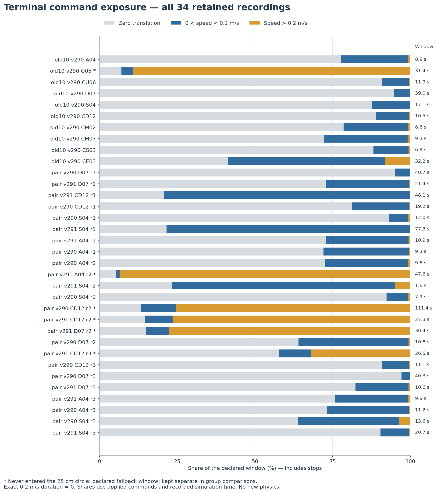
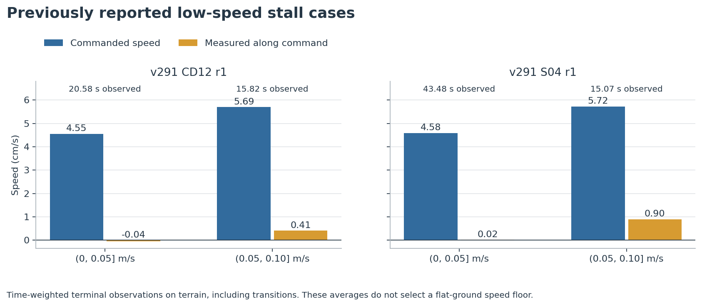
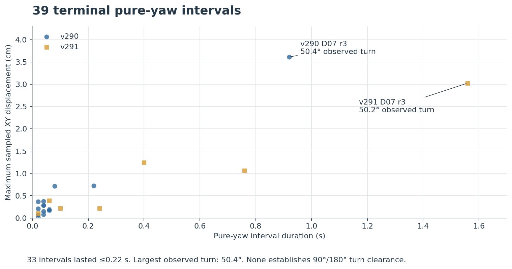

# Phase A — V12 terminal command-range audit

2026-10-23. **Phase A passed: all 34 retained runs analyzed, 102 source-file identities matched, zero new physics.** G1 was explicitly approved in this session. Branch `local/research-unpublished`; no push. Phase B is unrun, Phase C has not started, and G2/G3 are pending.

## What the recordings establish

**The current terminal spends almost all its moving-command time in the low-speed range, and v291 can remain there with almost no useful progress.** Among the 28 runs that actually entered the 25 cm goal circle, 86.20–99.87% of nonzero translation time was at or below 0.2 m/s. The paired v291 group spent 114.44 of 115.01 nonzero-command seconds in that band (99.50%). The denominator here excludes exact-zero translation; the all-window shares below include stops.

Two previously reported stall cases make the practical issue clear. In v291 CD12 r1, the (0,0.05] m/s band lasted 20.58 s: average commanded speed 0.04548 m/s, average measured speed along that command −0.00038 m/s. In S04 r1, the same band lasted 43.48 s: 0.04582 m/s commanded, 0.00018 m/s along the command. Measured total XY speeds were 0.01093 and 0.00447 m/s respectively: some body motion was sideways or oscillatory rather than useful commanded progress.

**Short pure-yaw execution is present, but 90°/180° turning capability is still unmeasured.** Across 39 terminal pure-yaw intervals, total exposure was only 6.297 s; 33 intervals lasted at most 0.22 s. The longest interval lasted 1.559 s, turned 50.2°, and displaced the body by at most 3.03 cm. The largest observed heading change was 50.4° in a 0.919 s interval at +1.0 rad/s; its maximum XY displacement was 3.61 cm. These are observed short arcs on terrain, not a turn-drift margin for an entire half turn.

**The training-floor premise was corrected.** The saved V12 config enables dynamic resampling; the fixed ≤0.2 m/s zeroing belongs to the other branch. See [the dated source correction](../../../../../.trellis/tasks/10-23-v12-terminal-turn-stop/research/evidence.md#3-v12-command-sampling-and-the-low-speed-hypothesis-corrected-2026-10-23). Phase A supports a low-speed execution problem; Phase B must measure `v_floor`, `wz_turn`, `turn_drift_margin` and `stop_distance(v)`. No such values are selected here.

## Group comparisons — actual goal-circle windows only

These time-weighted groups include terrain and braking transitions. They are descriptive; different available runs and long failures change their mix. Ratios above one in the parent can reflect residual motion after command reduction. They do not establish better steady tracking.

| Group | Runs entering circle | Low-speed time / nonzero time (s) | Low share of nonzero | Low-band command (m/s) | Body XY speed (m/s) | Along-command speed (m/s) | Along-command ratio |
|---|---:|---:|---:|---:|---:|---:|---:|
| original10 v290 | 9 | 29.40 / 32.44 | 90.63% | 0.079 | 0.118 | 0.096 | 1.212 |
| paired24 v290 | 11 | 25.09 / 26.19 | 95.80% | 0.068 | 0.104 | 0.084 | 1.229 |
| paired24 v291 | 8 | 114.44 / 115.01 | 99.50% | 0.056 | 0.028 | 0.017 | 0.308 |

## All 34 runs

Circle means the first post-goal XY entry within 25 cm through recording end. **Fallback** means the run never entered: ten seconds before its first post-goal all-zero command, clipped to observed navigation start, through recording end. All six fallback runs were historical scanner failures; they are retained separately, not interpreted as terminal arrival. Three additional scanner failures did enter the circle and remain in the circle group. No historical outcome was reclassified.

Low = 0 < speed ≤0.2 m/s; high = speed ≥0.2 m/s. Exact-0.2 exposure was **0 s** in this cohort, so the inclusive overlap contributes nothing here. All-window shares include stops. Drift is the largest sampled XY displacement among each run’s pure-yaw intervals; “—” means no interval, not zero drift.

| Run | Window | Window s | Low / all % | High / all % | Low / nonzero % | Total yaw s | Longest yaw s | Max yaw drift cm |
|---|---|---:|---:|---:|---:|---:|---:|---:|
| v290_A04_attempt01 | circle | 8.86 | 21.67 | 0.68 | 96.97 | 0.080 | 0.080 | 0.418 |
| v290_G05_attempt01 | **fallback** | 31.45 | 3.82 | 89.12 | 4.11 | 0.000 | 0.000 | — |
| v290_CU06_attempt01 | circle | 11.91 | 8.72 | 0.50 | 94.55 | 0.120 | 0.120 | 1.245 |
| v290_D07_attempt01 | circle | 39.02 | 5.07 | 0.15 | 97.06 | 0.000 | 0.000 | — |
| v290_S04_attempt01 | circle | 17.11 | 12.03 | 0.23 | 98.10 | 0.100 | 0.060 | 0.272 |
| v290_CD12_attempt01 | circle | 10.51 | 10.65 | 0.38 | 96.55 | 0.040 | 0.040 | 0.247 |
| v290_CM02_attempt01 | circle | 8.58 | 20.75 | 0.70 | 96.74 | 0.040 | 0.040 | 0.049 |
| v290_CM07_attempt01 | circle | 9.33 | 26.98 | 0.86 | 96.92 | 0.040 | 0.040 | 0.209 |
| v290_CS03_attempt01 | circle | 6.76 | 11.24 | 0.59 | 95.00 | 0.040 | 0.040 | 0.709 |
| v290_CE03_attempt01 | circle | 32.16 | 50.47 | 8.08 | 86.20 | 1.019 | 0.600 | 3.049 |
| pair24_v290_D07_r1 | circle | 40.72 | 4.66 | 0.20 | 95.96 | 0.000 | 0.000 | — |
| pair24_v291_D07_r1 | circle | 21.45 | 26.84 | 0.28 | 98.97 | 1.259 | 0.760 | 1.248 |
| pair24_v291_CD12_r1 | circle | 48.08 | 79.16 | 0.17 | 99.79 | 0.000 | 0.000 | — |
| pair24_v290_CD12_r1 | circle | 19.22 | 18.41 | 0.31 | 98.33 | 0.200 | 0.080 | 0.713 |
| pair24_v290_S04_r1 | circle | 11.99 | 6.17 | 0.67 | 90.24 | 0.040 | 0.040 | 0.373 |
| pair24_v291_S04_r1 | circle | 77.34 | 78.29 | 0.10 | 99.87 | 0.000 | 0.000 | — |
| pair24_v291_A04_r1 | circle | 10.91 | 26.56 | 0.55 | 97.97 | 0.060 | 0.060 | 0.387 |
| pair24_v290_A04_r1 | circle | 9.31 | 27.47 | 0.43 | 98.46 | 0.040 | 0.040 | 0.076 |
| pair24_v290_A04_r2 | circle | 9.57 | 26.72 | 0.63 | 97.71 | 0.220 | 0.220 | 0.726 |
| pair24_v291_A04_r2 | **fallback** | 47.64 | 1.05 | 93.53 | 1.11 | 0.000 | 0.000 | — |
| pair24_v291_S04_r2 | circle | 1.62 | 71.60 | 4.94 | 93.55 | 0.000 | 0.000 | — |
| pair24_v290_S04_r2 | circle | 7.88 | 6.85 | 0.76 | 90.00 | 0.040 | 0.040 | 0.284 |
| pair24_v290_CD12_r2 | **fallback** | 111.42 | 11.39 | 75.37 | 13.13 | 0.000 | 0.000 | — |
| pair24_v291_CD12_r2 | **fallback** | 27.31 | 8.86 | 76.49 | 10.38 | 0.000 | 0.000 | — |
| pair24_v291_D07_r2 | **fallback** | 30.37 | 7.18 | 77.74 | 8.45 | 0.000 | 0.000 | — |
| pair24_v290_D07_r2 | circle | 10.78 | 35.43 | 0.56 | 98.45 | 0.020 | 0.020 | 0.061 |
| pair24_v291_CD12_r3 | **fallback** | 26.55 | 10.39 | 32.00 | 24.51 | 0.000 | 0.000 | — |
| pair24_v290_CD12_r3 | circle | 11.11 | 8.63 | 0.54 | 94.12 | 0.020 | 0.020 | 0.212 |
| pair24_v290_D07_r3 | circle | 40.27 | 2.73 | 0.10 | 96.49 | 0.919 | 0.919 | 3.613 |
| pair24_v291_D07_r3 | circle | 10.63 | 17.11 | 0.56 | 96.81 | 1.799 | 1.559 | 3.027 |
| pair24_v291_A04_r3 | circle | 9.83 | 23.37 | 0.81 | 96.64 | 0.020 | 0.020 | 0.099 |
| pair24_v290_A04_r3 | circle | 11.23 | 26.33 | 0.53 | 98.01 | 0.100 | 0.060 | 0.160 |
| pair24_v290_S04_r3 | circle | 13.59 | 32.50 | 3.68 | 89.84 | 0.080 | 0.060 | 0.366 |
| pair24_v291_S04_r3 | circle | 20.69 | 9.18 | 0.39 | 95.96 | 0.000 | 0.000 | — |

Per-band command/body-speed comparisons for every run and all 39 pure-yaw intervals, including applied yaw rates and source rows, are in [TABLES.md](TABLES.md). Exact machine-readable values: [bands.json](results/bands.json), [pure_yaw_intervals.json](results/pure_yaw_intervals.json), [summary.json](results/summary.json).

## Method, checks and retention

- [DEFINITIONS.md](DEFINITIONS.md), analysis source, tests and the 34-run request were frozen in [frozen.json](frozen.json) before extraction. Fourteen synthetic boundary, interval, direction, clock, missingness and hash checks passed.
- The read-only extractor used the existing ultra9 worker Python under `nice -n 19`; 133,924 telemetry rows were analyzed. All 102 used source files, totaling 2,042,543,585 bytes, matched historical SHA-256 and sizes and remained stable during reads.
- Extraction produced 34/34 valid records: 28 circle windows, six declared fallbacks, zero missing runs, zero analysis errors. Actual remote analysis took 12.34 s; SSH and local launch took 18.86 s. The prior 20–40 minute figure was a budget estimate, not measured runtime.
- [verification.json](results/verification.json) checks run order, source freeze, source identity, duration partitions, inclusive-band overlap and interval totals. All window sample gaps stayed below the declared 0.04 s reporting threshold (exact values retained per run).
- Originals remain at the absolute paths in [request.json](request.json) and the extraction’s source records. No remote file, simulator, controller, policy, threshold, recorded outcome or failure was changed. [extract01.receipt.json](results/extract01.receipt.json) binds the returned compact stream to its execution.
- Re-analysis instructions: run `source/summarize.py`, then `source/render.py` and `source/write_report.py` locally against the retained compact output. Do not rerun `source/run_audit.py`: `extract01` is create-exclusive, and no replacement extraction is needed. Plot/report rendering is derived local presentation, separate from the frozen remote metrics.

## Next gate

Proceed to the flat-ground matrix at G2. The mandatory matrix is 31 cells ×3 fresh starts =93 runs, not the suggested cap of40. Recommend the full required matrix on ultra9 with v216 stance, optional v291-assistance arm omitted, ≤120 simulated seconds per run and a four-hour total wall budget. Freeze exact commands, metrics, ordering, source and module identities before the first run. Stop on the cap; retain unrun cells as unrun and all failures without replacement. No v292 implementation or Building evaluation before the earlier phases and their gates.
