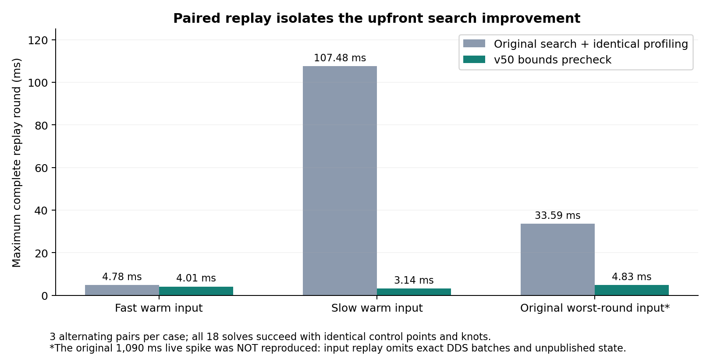
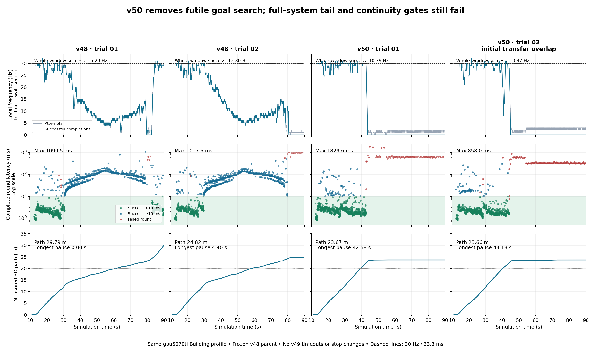

# v50 performance comparison: upfront search improved; full-run objective failed

Stage: experiment + analysis. Executed on gpu5070ti on 2026-10-01.
Direct implementation and native-source parent: **v48**. v49 remains frozen,
rejected and outside this lineage. v50 is also frozen; results below are separate
from its immutable pre-run source manifest. **The runnable reference remains v48.**

The conservative goal-neighborhood precheck removes the measured expensive
upfront search. In paired recorded-input replay, the maximum across the three
cases falls from **107.481 ms to 4.827 ms (95.5%)**, with identical accepted control
points and knots. All builds and component safety tests pass.

**Extreme full-system tails are not eliminated.** The two v50 physical runs peak
at **1,829.626 ms** and **858.031 ms**, respectively. Both stall near the corridor
corner after about 23.7 m, and whole-window successful planning is only
10.39–10.47 Hz. Therefore v50 does **not** pass the maximum-latency, continuity or
30 Hz acceptance criteria. The replay improvement is not a full-run success.

## Change and preserved contracts

The costly path was `getLocalTarget -> adjustGlobalTargetIfOccupied ->
findGoalNeighborhoodPath -> AstarSearch`, before warm initialization. v50 proves
that some final-goal tolerance neighborhoods cannot contain an eligible endpoint
inside the rolling map. Such searches return the original empty-search failure
immediately and enter the unchanged frontier/window fallback. A possibly eligible
endpoint retains native search. The proof uses necessary geometric bounds and
the original search-plane lattice, not an arbitrary distance cutoff or cached
safety verdict. See [implementation and proof](IMPLEMENTATION.md).

Passive wall/thread-CPU timers separately measure target selection, goal search,
input application, map updates, seed/warm initialization, optimization, refinement
and final validation. There is no v49 deadline, cancellation checkpoint, new stop
reason, changed timeout policy, worker thread or asynchronous trajectory handover.
The inherited native A* 200 ms limit is unchanged.

[Identity checks](continuity_contract_identity.json) bind 12 unchanged native
function bodies and 14 unchanged backend/configuration/controller files to v48.
Final goal/yaw, PVA/dynamic limits, minimum cruise, ownership, remaining-curve
validation, collision/stair support, freshness, admission and stop handling are
preserved. Byte identity and component tests do not prove successful physical
continuity through every map state; that acceptance remains failed below.

## Paired replay: isolated upfront improvement

Each case uses three alternating baseline/candidate pairs on the same binary.
The baseline path disables only the new precheck; passive instrumentation is
identical on both paths. Inputs come from the original v48 trial01 observer
messages, point clouds and support geometry. All **18 full replay rounds succeed**
and paired control points/knots match exactly.

| Recorded input case | Original-path median / max (ms) | v50 median / max (ms) | Median goal-search wall time before → after (ms) |
|---|---:|---:|---:|
| Fast warm | 4.001 / 4.785 | 3.978 / 4.012 | 0.0033 → 0.0033 |
| Slow warm, original simulation 55.906 s | 106.004 / 107.481 | 3.128 / 3.143 | 102.951 → 0.052 |
| Original worst-round input, simulation 78.998 s | 33.403 / 33.590 | 4.805 / 4.827 | 28.311 → 0.039 |

The slow-warm goal-search CPU time similarly falls from 102.939 to 0.052 ms,
supporting removal of computation rather than a scheduling-only explanation.
The original live log had reported about 134 ms of final-goal search in this
slow-warm region; repeated replay is a different measured execution.

**Replay limit:** observer receive order does not reconstruct exact native DDS
drain batches, feasible-window hints, or all unpublished failed-attempt state.
Warm ownership is reconstructed from observed accepted splines/routes, which
can omit internal invalidation between publications. The original 1,090 ms live
multi-refresh/retry spike is **not reproduced** by the fixed-input case. It must
not be reported as a measured reduction from 1,090 ms to 4.8 ms.

Sources: [paired summary](analysis/paired_profile_summary.json),
[original profile output](profiles/attempt02/return_manifest.json).

## Physical comparison: all attempts retained

All four runs use the same bounded 90 simulation-second Building profile,
factory-PD startup, stance hold, single backend executor, ZMQ transport, target
RTF 1 and six-CPU native container on gpu5070ti. v48 trial01 is the historical
reference; v48 trial02 is an unchanged control executed after both v50 runs.
Source/build hashes are verified by each launcher before physics.

| Run | Complete-round max (ms) | Whole-window attempts / successful completions (Hz) | Measured 3D path (m) | Longest measured pause ≥1 s (s) | RTF |
|---|---:|---:|---:|---:|---:|
| v48 trial01, historical | 1,090.481 | 15.40 / 15.29 | 29.79 | none | 0.9528 |
| v48 trial02, unchanged control | 1,017.612 | 12.98 / 12.80 | 24.82 | 4.40 | 0.9526 |
| v50 trial01 | **1,829.626** | 11.29 / 10.39 | 23.67 | **42.58** | 0.9286 |
| v50 trial02 | 858.031 | 12.13 / 10.47 | 23.66 | **44.18** | 0.9231 |

All four have zero logged emergency-state transitions, zero
`remaining_spline_invalid` events, no final arrival result, and no complete-route
acceptance. These zero counts alone do not certify collision-free or continuous
navigation. A robot can stall without entering emergency stop.

**Trial02 limitation:** returning v50 trial01 artifacts briefly overlapped the
beginning of v50 trial02. The transfer was paused, then resumed after completion;
see [transfer record](analysis/artifact_transfer_pause.json). Do not use that run
as an isolated benchmark or cherry-pick its lower maximum. v50 trial01 and the
new v48 control had no concurrent artifact transfer. No run is dropped from the
report because of its outcome.

**Rate definition:** count attempts and successful *completions* over the same
original navigation pacing wall interval, including stalled time. This differs
from earlier `(N-1)/(last event-first event)` summaries; those would report
29.07 Hz for v50 trial01 successes by excluding its post-success stall. The
historical v48 15.859 Hz attempt figure uses that older event-interval definition.
Both are retained with explicit names in the machine-readable metrics. Round
maxima in the table occur inside the pacing window and match all-log maxima.
The plot uses trailing one-wall-second counts, sampled every 50 ms and mapped
to simulation time through observed native timestamps. Dashed limits are 30 Hz
and 33.3 ms. Its green latency band denotes <10 ms, not proof of warm-start use.

The new v48 control also ends near the same corridor corner as v50, at roughly
(7.80, -4.16, 1.85) m. This weakens any claim that the v50 precheck alone caused
the stall. v50 reaches the difficult area much earlier, exposing the persistent
cold-planning condition for more of the fixed recording. The runs follow
different timed trajectories; they do not isolate the causal origin of that
condition. Regardless of cause, the requested end-to-end acceptance fails.

## Matched progress: improvement before the corner

The first 20 m of cumulative measured 3D path is a common-progress segment, not
an identical-state replay. It includes the climb and excludes the later corner
stall. Every run is included; this segment does not replace full-run acceptance.

| Run | Time reaching 20 m (simulation s) | Attempt interval rate (Hz) | Mean / P95 / max solve (ms) |
|---|---:|---:|---:|
| v48 trial01 | 60.97 | 17.67 | 30.73 / 131.81 / 397.82 |
| v48 trial02 | 58.20 | 18.50 | 29.37 / 120.93 / 202.89 |
| v50 trial01 | 39.31 | 28.95 | 5.20 / 13.47 / 178.04 |
| v50 trial02, transfer caveat | 40.33 | 28.67 | 5.48 / 17.88 / 302.11 |

v50 improves the common part of the route substantially, but even this segment
still has >100 ms tails. A near-30 Hz average is not a strict 30 Hz result.

## Remaining extreme tail: cold recovery and fresh input application

The longest v50 trial01 round starts at simulation **44.951923 s** and fails after
**1,829.626443 ms**. It performs **12 seed attempts, 12 optimizer calls, six
fixed-height recoveries and three target selections**. There is no accepted warm
seed and no goal-bound rejection in that round. The goal search itself consumes
only **0.029 ms**. Across the entire run its maximum is **0.119 ms** (trial02:
0.159 ms), so the eliminated upfront search is no longer the extreme-tail source.

| Inclusive stage in worst v50 round | Wall time (ms) | Thread CPU time (ms) | Calls |
|---|---:|---:|---:|
| Target selection | 27.838 | 27.822 | 3 |
| Goal search, nested in target | 0.029 | 0.029 | 3 |
| Input refresh, also nested within planning stages | 475.323 | 433.655 | 40 |
| Cloud application, nested in refresh | 471.141 | 429.491 | 17 |
| Seed initialization/search | 666.851 | 666.248 | 12 |
| Optimization, including its refreshes | 980.663 | 938.923 | 12 |

**Do not sum these rows:** timers are inclusive and overlap. The CPU measurements
show substantial real computation, not just wall scheduling delay. The log
repeats `rebound_no_valid_new_constraints` and sometimes reports the first three
control points occupied. This identifies the failed cold retry chain, not a
proven reason to bypass its checks. Trial02's 858 ms extreme similarly has nine
seed attempts, six optimizer calls and 211 ms of input refresh.

Evidence: [exact worst-round lines](analysis/trial01_max_round_diagnosis.json),
[original trial01 log](../../runs/v50_realtime_trial01/scan.log),
[trial02 maximum](analysis/v50_realtime_trial02_max_round.json).

## Build, safety and artifact gates

- Offline native build01 passes; 100 native source files and 518 installed files
  are hash-bound. The full v50 source freeze contains 6,611 files.
- Final test02 passes **35 native, 48 cache, 94 warm-start and 24 recorded-map
  goal-region checks**, **500 randomized exhaustive endpoint-eligibility cases**,
  and **17 backend tests**. Recorded cold geometry matches the frozen parent
  oracle. All 18 paired profiling rounds retain exact output geometry.
- Backend tests exercise the actual unchanged admission handler, command gate
  and adapter: original `native_replan_exhausted` ownership, zero-command gating,
  rejection of wrong-owner notices, hold acknowledgment and measured-stillness
  dwell. These use controlled acknowledgment/state fixtures, not a physical
  emergency-stop demonstration. Native stop function bodies remain identical.
- All attempts, including the initial profiling packaging failure, are preserved.
  Final originals, hashes, source preservation and local copyback are checked by
  [evidence verification](analysis/evidence_verification.json). Each physical
  runner records bounded completion and owned-container cleanup.

See [component qualification](COMPONENT_RESULTS.md),
[machine-readable gates](component_qualification.json),
[acceptance](acceptance.json), and [source manifest](manifest.json).
The manifest/component documents describe the immutable **pre-physics** freeze;
this report and acceptance record supply the later runtime outcome.

## Next boundary

Keep v50 as a measured, non-accepted candidate and keep v48 as the experimental
reference; v48 itself is not generally validated or a reliable complete-route
baseline. No frozen source is changed after these runs.

The next logical version should first capture the **exact cold failure state**:
active curve and ownership, route/window hints, map/support generations, reference
PVA and every input batch applied during the retry chain. Reproduce the rejected
start/control-point condition and repeated rebound constraints before changing
behavior. Only then eliminate demonstrably identical search/constraint work under
the same input generation; a new input generation must force fresh validation.
This is a proposed investigation, not implemented caching or a proven fix. No
hard deadline, stop-protocol change, restamped old curve or skipped safety check
is justified by the current evidence.

Reproduce the report data/figures with `analysis/compare_trials.py`; verify local
originals with `analysis/verify_evidence.py`. [Metric provenance](analysis/comparison_provenance.json)
binds the original inputs and analysis code. PNG/PDF/SVG figures and per-run CSVs
are available in `analysis/`.
