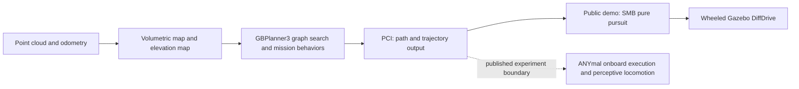

# UAS quadruped code audit

## Decision

Do not replace the complete Lite3 PCT–SCAN navigation chain with the current
public Unified Autonomy Stack to save integration work. The public UAS ground
planning and mapping components are substantial, but the inspected distribution
does not provide the terrain-aware reactive execution and locomotion used by
its ANYmal D experiments. Replacing SCAN would leave that responsibility with
us. The public UGV example instead closes the loop with a wheeled simulator and
a simple path follower.

This is a source-backed engineering judgment, not a measured head-to-head
reliability result. No UAS build, simulator, learned model, or robot was run.
The existing Lite3 stack is also not thereby certified as generally reliable.

The most useful limited adoption would be to evaluate OmniPlanner as an
alternative route/exploration source while preserving a qualified Lite3 local
execution layer. Its online exploration and global graph are more relevant to
unknown-space missions than to simply replacing an existing route in a known
multi-floor map.

## Scope and pins

- UAS root: `ntnu-arl/unified_autonomy_stack`, main,
  `cb78bf7f57d074fc0999dd23bb1cfa1b1754d44d`.
- Ten selected dependencies were acquired at the UAS `_exact.repos` pins.
  Read-only sparse checkouts omit model binaries, media, and map assets.
- The default import script uses moving references unless `--exact` is passed.
  We resolved those references and also inspected current `robot_bringup`,
  `rl_nav`, `mimosa`, and `cbf_pc_selector`, plus the separate default branches
  of `gbplanner_ros` and `pci_general`.
- `acquisition.json`, `current_acquisition.json`, `moving_refs.json`,
  `branch_diffs.json`, and `source_inventory.json` retain pins and provenance.
  `repository_manifest.yaml` records interfaces, licenses, and original commands.
- Acquisition did not execute upstream installation scripts or fetch recursive
  dependencies. This is a reference acquisition, not adoption as the VLA baseline.

The distinction between branches matters. UAS selects `gbplanner3_test`
(`7b10f8f`) rather than the public `gbplanner3` default (`f9904bb`). It selects
`pci_general/dev/unified_autonomy_stack` (`1e5f5c6`), whose output differs from
`pci_general/main` (`152eb2d`). Mixing their documentation and interfaces would
produce a misleading integration estimate.

## Data flow actually present in public source

The dashed connection marks an experimental dependency described in the paper,
not a fully traced public ANYmal adapter. The actual deployed ANYmal transport,
message names, controller implementation, and controller weights are not
established by the inspected public source.

### 1. Sensing, localization, and maps are real public implementations

`mimosa` implements the estimator rather than wrapping an unavailable ANYmal
localization service. At the current main pin `322b89e`,
`mimosa/src/mimosa_node.cpp:33–48` constructs IMU, graph, LiDAR, radar, and odometry
managers. The root README documents both LiDAR–radar–IMU and LiDAR–IMU variants.
Adopting all sensors from the experiment is not required just to supply the
planner with odometry and point clouds; reproducing its degraded-perception
performance would require comparable sensing and calibration.

UAS `robot_bringup/launch/ros1/gbplanner_sim.launch:25–48` wires the planner to
odometry, a point cloud, and `/elevation_mapping_lidar/elevation_map_raw`, and
optionally starts the public elevation-mapping node. The robot launch at
`launch/ros1/gbplanner_robot.launch:20–35` uses MIMOSA cloud data and MSF odometry,
but its shipped `config/ros1/gbplanner/robot/gbplanner_config.yaml:7` selects
`kAerialRobot`. It is not an ANYmal deployment preset.

The UGV example's elevation map is configured at 0.2 m resolution with a
`perfect` sensor processor and no robot-pose covariance input. These are demo
settings, not evidence of a ready-calibrated Lite3 perception configuration.
See `robot_bringup/config/ros1/gbplanner/ugv_sim/elevation_mapping_config.yaml:1–22`.

### 2. Ground traversability and graph planning are open

At the UAS planner pin, `gbplanner/src/rrg.cpp:571–636`,
`Rrg::projectSampleEleMap` checks an elevation value at the center and four
offset samples, places the reference height at terrain height plus
`max_ground_height`, and applies `max_inclination` tests. The associated edge
function at `rrg.cpp:737–845` projects points, checks slope, and checks body-box
occupancy in the volumetric map.

At the separate current `gbplanner3` default, the corresponding function starts
at `rrg.cpp:580` and uses a configurable `robot_params_.footprint` for those
offsets. This improves parameterization but is still a geometric support and
clearance abstraction. It is not a leg-joint/foot-contact rollout of our Lite3
policy, nor an implementation of ANYmal's perceptive locomotion.

The public planner contains local exploration, global exploration, homing, and
target-navigation behavior. Current default `gbplanner_bt_nodes.cpp:68–84`
calls `getLocalNavigationPath`; `gbplanner.cpp:1269–1274` accepts a target. The
word “local” here must not be mistaken for a separate terrain-aware robot
controller. Ground graph planning can avoid obstacles; the missing layer is
not all obstacle avoidance, but the demonstrated reactive execution capability.

The height map used by this code has one elevation value per XY cell. The
volumetric map and global graph retain 3D information. This does not prove that
multi-floor navigation is impossible, but stacked floors, landings, and floor
switching require explicit evaluation; “3D” in the project title is not enough.

### 3. The public output interface is a route, not four-leg control

At `pci_general@1e5f5c6`, `src/pci_general.cpp:12–15` advertises
`trajectory_msgs/MultiDOFJointTrajectory` on `command/trajectory` and
`nav_msgs/Path` on `/gbplanner_path`. `executePath` prepares the path and
publishes those messages at lines 670–682. There is no twelve-joint Lite3/ANYmal
controller at that boundary.

The separately inspected main branch uses `PoseArray` and optionally a generic
`planner_msgs/pathFollowerAction` client (`src/pci_general.cpp:384–401`). An
action client awaiting another server does not supply that server's physical
controller. Its old `PCI_ANYMAL` include guard is not evidence that an ANYmal
motion stack is bundled.

### 4. The ready-made public ground demo is wheeled

UAS `docker-compose.ugv_sim.yml:133` selects `robot_name:=smb_arl`,
`config_name:=ugv_sim`, and elevation mapping. The current bringup still uses
`launch/ros2/ugv_sim.launch.xml:16–17` to select `smb_arl`, and lines 55–58 connect
`/gbplanner_path` to `ugv_gz/scripts/path_tracker.py` and then `cmd/vel`.

The follower subscribes to path and odometry (`path_tracker.py:48–65`). Its
`calculate_distance` is XY-only (99–103); reaching the end results in a zero
velocity message (128–147). It has no input for terrain, foot contacts, or
measured standing ownership. The model uses four wheel joints and Gazebo's
`DiffDrive` plugin (`resources/robots/smb_arl/model.sdf:309–322`).

There is a legacy ANYmal model file inside GBPlanner's tree. A model file alone
does not provide the actual ANYmal D experiment's software, sensors, or
perceptive controller. The audited official UGV launch does not select it.

### 5. NMPC, RL, and CBF are public, but implement aerial control

| Module | Direct code evidence | Consequence for Lite3 |
|---|---|---|
| SDF-NMPC | `sdf-nmpc/sdf_nmpc/gen_model.py:7–22` selects `quad_acc`, attitude, or propeller models. `model/quad_acc.py:12–33` has freely commanded 3D acceleration and yaw-rate dynamics. `sdf_nmpc_ros/scripts/sdfnmpc_node.py:144–156` publishes MAVROS acceleration setpoints. | Requires a new ground-motion model, terrain/support constraints, interface, and verification. Clamping vertical acceleration to zero is not a complete conversion. |
| RL navigation | Current `rl_nav@93ce43e/README.md` identifies UAV training in Aerial Gym. The actual node writes three acceleration components into MAVROS at `scripts/lidar_nav_acc_ros2_node.py:449–466`. Public checkpoints are aerial policies; their binaries were not loaded here. | A `Twist` message and even an old `/cmd_vel` name do not imply the Lite3 body-velocity contract. No public Lite3/ANYmal perceptive locomotion policy was identified in this package. |
| Composite CBF | `composite_cbf/src/CbfSafetyFilter.cpp:111–129` corrects body acceleration against obstacle points; `CompositeCbfNode.cpp:162–177` emits MAVROS acceleration setpoints. | This is not a guarantee of support or feasible four-foot motion. A terrain-aware ground adaptation remains work. |

This agrees with the [paper](https://arxiv.org/html/2605.12735v1), sections 3.4,
4.1.2, 4.4.2, and 5: current reactive modules primarily target flying robots;
the ANYmal experiment uses its commercial perceptive locomotion; future work
includes traversability-aware reactive modules for ground systems.

### 6. What the ANYmal experiment supplies outside this release

The paper describes ANYmal D's onboard computers running locomotion and
velocity tracking, and its surrounding depth cameras supporting perceptive
locomotion. In the mine experiment, the additional UAS navigation safety layers
were disabled because ANYmal provided partially analogous near-term
traversability-aware motion. The pinned public documentation confirms this at
`unified_autonomy_stack/docs/indicative_results.md:149`.

We found no ANYmal-specific execution package, perceptive locomotion weights,
or matched ANYmal D full-stack launch in the audited dependency manifests and
bringup/controller sources, including the compared current branches. This is a
statement about the inspected public distribution. It is not a claim about
every repository or a reconstruction of undocumented ANYmal internals.

## Release and reproducibility observations

1. The default installer resolves moving branches; `--exact` is needed to use
   the supplied fixed pins. The difference is material: `robot_bringup`,
   `rl_nav`, `mimosa`, and `cbf_pc_selector` had changed at inspection time.
2. UAS selects ROS 1 Noetic for the planner and ROS 2 Humble for several other
   components, with a ROS bridge. This does not simplify our existing Foxy
   integration automatically. Using just the route planner can avoid adopting
   every container.
3. `ws_sim.repos` includes `ntnu-arl/helicopter_bridge`, unavailable to an
   unauthenticated GitHub API request (HTTP 404) on this date. The installer
   exits on workspace import failure. This is independently consistent with
   [issue 12](https://github.com/ntnu-arl/unified_autonomy_stack/issues/12).
   It is an unrelated aerial dependency that could be omitted for a scoped
   ground import; it is not proof that the ground planner itself cannot build.
4. The inspected root CI workflow deploys documentation; it is not an automated
   quadruped end-to-end test. This review does not claim that upstream has no
   internal tests.
5. Do not repeat the old claim that GBPlanner3 cannot reach unknown-space
   targets. The maintainer clarified and updated that behavior in
   [issue 71](https://github.com/ntnu-arl/gbplanner_ros/issues/71), and current
   code contains the target-navigation path. A GitHub issue being open does not
   mean its original report remains unresolved.

## Comparison with the local Lite3 work

The inspected local v206 controller already owns SCAN-to-tracker data flow,
route refresh/cancellation, one body-velocity output, and measured terminal
state feedback. Its README and `controller.cpp:157–184` show that boundary.
Replacing the route source is much smaller than replacing this whole chain.

The earlier v206 terminal failure has subsequently received a bounded v208
physical comparison: `versions/v208/results/physical_summary.json` records two
candidate initialized-state passes and zero new full-route runs. v209 is a
rendered comparison of those tests. Do not describe that one old failure as
still wholly unaddressed, and do not promote the two probes into general route
reliability. These records are comparison context, not new tests run here.

| Option | Work retained or added | Judgment |
|---|---|---|
| Replace both PCT and SCAN with public UAS | Add mapping/ROS integration, Lite3 planner calibration, a terrain-aware local executor, sensor-to-policy adaptation, stop/recovery feedback, and a full qualification suite. | High effort; not a shortcut. No evidence of better Lite3 reliability. |
| Replace only the global route source with OmniPlanner | Retain SCAN/tracker/Lite3 policy; adapt graph planner inputs and path/goal semantics; evaluate floor transitions and blocked-route feedback. | Bounded medium effort; plausible for online unknown-space exploration. |
| Borrow a specific mechanism | Consider the explicit untraversable-polygon feedback interface (`gbplanner.cpp:1037–1054`), graph-level repositioning, or mapping components after a matched need is established. | Lowest disruption; each still needs its own acceptance check. |

These are relative engineering estimates, not calendar promises. Existing
integration work is relevant because it already implements required contracts,
not merely because time was spent on it.

If further work is selected, the first useful experiment is an isolated
OmniPlanner route-generation comparison using recorded Lite3 cloud/odometry and
frozen targets. Measure correct floor connectivity and terrain admissibility
before wiring output to movement. Then compare closed-loop behavior with the
same local controller, locomotion policy, sensors, and terminal criteria. This
review did not run or implement that proposed experiment.

## Evidence limitations

Public papers and author demonstrations establish original-system evidence.
Source inspection establishes available implementations and contracts. Neither
establishes a Lite3 success rate. Model binaries, full datasets, and simulator
assets were not evaluated. The end-to-end ANYmal experiment cannot be reproduced
from the inspected package set alone without providing its external robot
execution capabilities.
